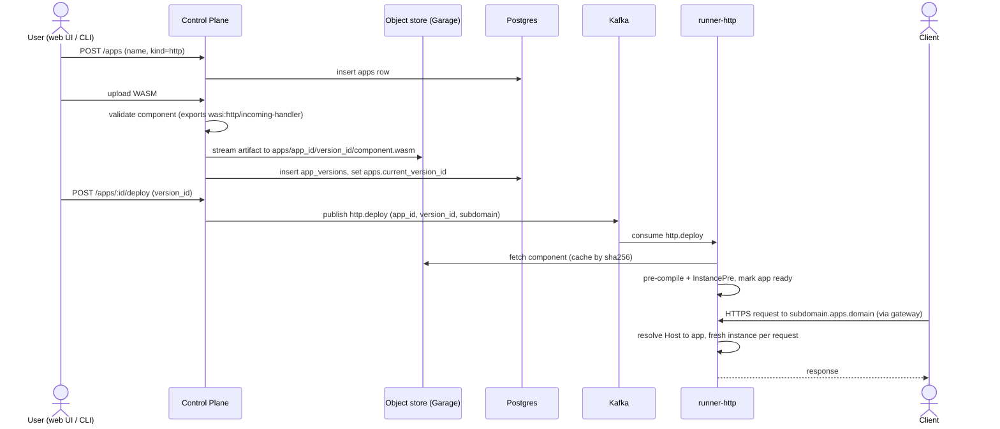
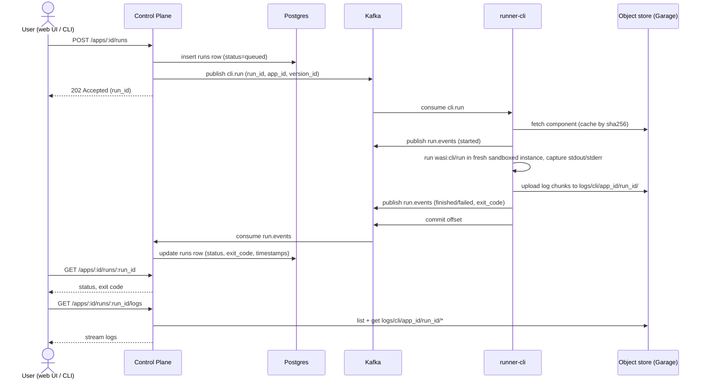
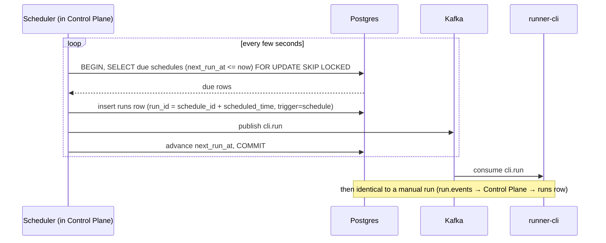

# Serverless Platform – Design Document

## Architecture Overview

```
                           Internet
                              │  HTTPS (web., api., *.apps.example.com)
                              ▼
                     ┌──────────────────┐
                     │  Gateway / Edge  │  TLS termination, wildcard cert,
                     │  (Envoy Gateway) │  host-based routing, load balancing
                     └──┬──────┬─────┬──┘
          ┌─────────────┘      │     └──────────────┐
          │ web.<domain>       │ api.<domain>       │ <app>.<domain>
          ▼                    ▼                    ▼
   ┌─────────────┐     ┌────────────────┐    ┌──────────────┐
   │ Web server  │     │ Control Plane  │    │ runner-http  │
   │ (UI)        │     │ HTTP API +     │    │ (Host → app) │
   └─────────────┘     │ scheduler      │    └──▲────────┬──┘
                       └──┬─────┬────┬──┘       │        │
                          │     │    │ produce  │ http.  │
                          │     │    ▼          │ deploy │
                          │     │ ┌───────┐     │        │
                          │     │ │ Kafka │─────┘        │
                          │     │ └───┬───┘              │
                          │     │     │ cli.run          │
                          │     │     ▼                  │
                          │     │ ┌────────────┐         │
                          │     │ │ runner-cli │         │
                          │     │ └─────┬──────┘         │
                          │     │       │ wasm, logs     │ wasm, logs
                          │     ▼       ▼                │
                          │  ┌────────────────────┐      │
                          │  │ Object store       │◀─────┘
                          │  │ (Garage)           │
                          │  └────────────────────┘
                          ▼
                    ┌──────────────────────────┐
                    │ Postgres                 │
                    │ apps, versions, env,     │
                    │ schedules, runs          │
                    └──────────────────────────┘
```

## Components

### Control Plane

HTTP API server (Rust, e.g. axum). Source of truth for everything the user configures. Has no UI of its own; the web server (below), CLI tools and scripts are all clients of this API. Served at `api.<domain>`.

Responsibilities:

- CRUD for **apps**: name, kind (`cli`/`http`), subdomain, env vars/secrets, resource limits.
- Upload of WASM artifacts → stream into object storage, record version + sha256 in Postgres.
- Validate the component on upload (is it a valid component, does it export `wasi:cli/run` or `wasi:http/incoming-handler`?).
- Trigger CLI runs (manual) and manage schedules.
- Publish **commands** to Kafka (`deploy`, `undeploy`, `run`).
- AuthN/AuthZ (API tokens initially).
- Expose run status/logs (logs are read from the object store and streamed to the client).
- Run the **scheduler**: a loop that turns due `schedules` rows into `cli.run` messages (see §6.2).
- Update the database with run results.

Stateless apart from the scheduler, which needs row claiming or leader election when running multiple replicas (§6.2); otherwise scale horizontally.

### Web Server

Serves the dashboard UI at `web.<domain>`. Separate deployment from the control plane so the UI can be built, deployed and scaled independently.

- Pure client of the control-plane API: no Postgres, Kafka or object-store access.
- The browser calls the API cross-origin at `api.<domain>`, so the control plane must allow `web.<domain>` via CORS (credentials allowed). Session cookies should be scoped to the exact API host, not to the parent domain.

### Object Storage

[Garage](https://garagehq.deuxfleurs.fr/) in-cluster (S3-compatible, Rust, single binary, built-in multi-node replication). Stores immutable WASM artifacts and logs. Code talks only to the generic S3 API (e.g. `object_store` / `aws-sdk-s3` crates), so swapping to SeaweedFS or real S3 later requires no code changes.

Why Garage: artifacts are small, immutable, written rarely and read on cold start (then cached), so only basic PUT/GET/multipart is needed. Garage covers that with minimal operational overhead.

- Key layout: `apps/<app_id>/<version_id>/component.wasm`.
- Runners fetch on demand and cache on local disk keyed by sha256 (immutable, so caching is trivially safe).

#### Logs

Guest stdout/stderr is captured by the runners and written to the object store, in a separate `logs` bucket (so retention and access keys can differ from artifacts).

- **CLI runs**: `runner-cli` buffers stdout/stderr (to a local temp file, not memory) and uploads it in numbered chunks every N seconds / M MB and once more when the run ends, before publishing the `finished`/`failed` event. Key: `cli/<app_id>/<run_id>/<seq>.log.gz`; a short run is a single chunk. Chunking makes logs visible while a long run is in progress and limits loss if the pod dies. The prefix is derived from `run_id`, so Postgres needs no extra column.
- **HTTP apps**: `runner-http` batches output per app and flushes a chunk every N seconds or M MB: `http/<app_id>/<yyyy-mm-dd>/<hh>/<pod>-<seq>.log.gz`. Time-prefixed keys let the API list a time range cheaply.
- **Format**: newline-delimited JSON (`ts`, `stream`, `line`, plus `request_id` for HTTP), gzip-compressed per object.
- **Limits**: per-run / per-app-per-hour byte caps; output beyond the cap is dropped with a truncation marker, so a noisy guest cannot fill the store.
- **Retention**: expire objects after a configurable period (e.g. 30 days), via a bucket lifecycle rule if supported, otherwise a periodic cleanup task in the control plane.
- **Reading**: only the control plane reads logs (`GET /apps/:id/runs/:run_id/logs`, `GET /apps/:id/logs?from=&to=`); runners have write-only credentials to the `logs` bucket.

### Postgres

Relational state owned by the control plane only (runners do not connect to it).

### Kafka

Used as the command bus between control plane and runners.

Topics:

- `cli.run` – "execute this app version once". Key = `app_id`.
- `http.deploy` – desired-state changes for HTTP apps (deploy / update / remove). Key = `app_id`, so ordering per app is preserved. Consider log compaction so a new runner can rebuild the current desired state.
- `run.events` – status events from runners (started, finished, failed) → control plane persists to `runs`.

Message contains only references (`app_id`, `version_id`, `artifact_key`, `sha256`, env ref, run_id) – never the WASM itself.

Delivery semantics: at-least-once. Runs must carry a `run_id`; the runner/control plane deduplicates on it. CLI apps should be documented as "may rarely run twice".

### Runners

Two separate Rust binaries, each built into its **own container image** and deployed as its own Deployment. Both embed Wasmtime and share a `runner-core` library crate (Wasmtime engine config, sandbox limits, WASI context building, artifact fetch + sha256-keyed cache), but are otherwise independent.

Why separate images: the two workloads have different dependencies (`wasmtime-wasi-http` + an HTTP server vs. a plain Kafka consumer), different scaling signals (RPS vs. consumer lag), and different security surfaces (`runner-http` receives internet traffic, `runner-cli` does not). Separate images keep each one smaller, let them be released and rolled back independently, and keep HTTP-serving code out of the CLI image.

- **`runner-cli`**: consumer group on `cli.run`. For each message: fetch/cached component → new `Store` with WASI context (env, limits) → call `wasi:cli/run` → emit result to `run.events`. Commit offset only after the run finishes (or after a hard timeout). Fresh instance per run for isolation; enforce fuel/epoch timeout, memory limit, no ambient filesystem/network unless granted.
- **`runner-http`**: subscribes to `http.deploy`. For each app assigned to it, loads the component and serves it with `wasmtime-wasi-http`, creating a fresh instance per request (cheap with pre-instantiation – `InstancePre`).

### Edge / Gateway

[Envoy Gateway](https://gateway.envoyproxy.io/) implementing the Kubernetes **Gateway API**, + cert-manager. Chosen over ingress-nginx because Gateway API is the standard successor to `Ingress` (portable `Gateway`/`HTTPRoute` resources instead of vendor annotations), Envoy applies config changes live via xDS without reloads, and ingress-nginx is being retired.

- One `Gateway` with HTTPS listeners for `api.<domain>`, `web.<domain>` and `*.apps.<domain>`; one `HTTPRoute` per target below.
- `api.<domain>` → control plane (HTTP API).
- `web.<domain>` → web server (UI).
- `*.apps.<domain>` → HTTP runner pool, load-balanced by consistent hash of the `Host` header (see Routing → Host hashing).
- TLS: wildcard certificate via cert-manager (DNS-01 challenge), referenced from the listener's `certificateRefs`.
- Rate limiting and request size limits at the edge (Envoy Gateway `BackendTrafficPolicy` / `ClientTrafficPolicy`).

## Key Flows

**Deploy an HTTP app**



**Manual CLI run**



**Scheduled CLI run** (details and failure handling in §6.2)



## Routing HTTP Requests to the Right App

**Shared runner pool (for the start)**
All HTTP runners can serve any app. The runner reads the `Host` header, looks up the app in its in-memory table (populated from `http.deploy`), loads/instantiates lazily. The gateway has one wildcard `HTTPRoute` → one Service. Adding an app needs no Kubernetes changes.

> Later change to for example a hash-based routing scheme.

## Cross-Cutting Concerns

- **Sandboxing**: Wasmtime limits (memory, table, instances), epoch interruption for timeouts, fuel optionally; capability-based WASI (deny network/fs by default). Runner pods run non-root, read-only rootfs, with NetworkPolicies restricting egress (e.g. block cluster-internal ranges and cloud metadata endpoint).
- **Secrets**: env values marked secret are encrypted at rest in Postgres (or referenced from k8s Secrets) and only resolved when building the WASI context.
- **Observability**: guest stdout/stderr stored in the object store (see Object Storage → Logs); Prometheus metrics (runs, durations, request latency, cold start, Kafka lag); tracing with OpenTelemetry.
- **Scaling**: CLI runners autoscale on Kafka consumer lag (KEDA). HTTP runners autoscale on CPU/RPS (HPA).
- **Failure handling**: CLI run retries are opt-in per app (default 0, since user code may not be idempotent); dead-letter topic for poison messages.
- **Versioning/rollback**: versions are immutable; deploy = pointer move; rollback = move it back.

## Local Development

**1. Unit tests with in-process fakes (no Docker)**

- **Object store**: all access goes through the `object_store::ObjectStore` trait (wrapped in `common`). Tests use `object_store::memory::InMemory`; `LocalFileSystem` is handy for manual debugging; prod uses `AmazonS3` pointed at Garage. No hand-written mock needed.
- **Kafka**: a small `CommandBus` trait in `common` (`publish(topic, key, msg)`, `subscribe(topic, group)`), with an in-memory implementation (tokio channels) for tests and an `rdkafka` implementation for real use. Control plane and runner logic are tested against the in-memory bus.
- **Postgres**: not mocked. Use `sqlx` with `#[sqlx::test]`, which creates a fresh database per test on a real Postgres. The scheduler's `FOR UPDATE SKIP LOCKED` claiming is only meaningful against real Postgres.
- **Wasmtime**: no mock; tests load the components built from `examples/`.

**2. Local stack with real dependencies (`docker compose`, services via `cargo run`)**

- `postgres` – plain image.
- Kafka – `apache/kafka` single node in KRaft mode (no ZooKeeper). An init step creates `cli.run`, `http.deploy`, `run.events`.
- Garage – `dxflrs/garage` single node (replication factor 1); an init script assigns/applies the layout and creates the `apps` and `logs` buckets plus a dev access key.
- No gateway: `runner-http` listens on `:8080` and routes by `Host`. `*.localhost` resolves to `127.0.0.1` in browsers and curl, so `http://hello.apps.localhost:8080` works without DNS or TLS. Control plane on `:3000`, web dev server on `:5173` (allowed via CORS).
- Configuration from env vars (`DATABASE_URL`, `KAFKA_BROKERS`, `S3_ENDPOINT`, `S3_ACCESS_KEY`, …) loaded from `.env`.
- `justfile` targets: `dev-up` / `dev-down` (compose), `build-examples` (`cargo build --target wasm32-wasip2`), `deploy-example` (upload + deploy via the API).

## Repository Layout

Cargo workspace:

```
control-plane/   # HTTP API + scheduler
runner-core/     # shared wasmtime host lib: engine, limits, WASI ctx, artifact cache
runner-cli/      # binary + image: Kafka cli.run consumer
runner-http/     # binary + image: wasi:http server, Host-based routing
common/          # shared types: Kafka message schemas, app model, storage client
web/               # dashboard UI (web server)
examples/          # sample wasm apps
deploy/            # Helm chart / kustomize manifests
deploy/dev/        # docker-compose.yml, garage-init.sh, Kafka topic init
docs/
justfile           # dev-up, dev-down, build-examples, deploy-example
.env.example       # local config (DATABASE_URL, KAFKA_BROKERS, S3_*)
```
