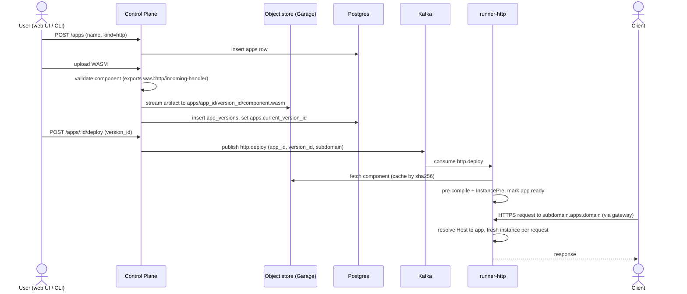

# Serverless Platform – Design Document

## Architecture Overview

```
                           Internet
                              │  HTTPS (web., api., *.apps.example.com)
                              ▼
                     ┌──────────────────┐
                     │  Gateway / Edge  │  TLS termination, wildcard cert,
                     │  (Envoy Gateway) │  host-based routing, load balancing
                     └──┬──────┬─────┬──┘
          ┌─────────────┘      │     └──────────────┐
          │ web.<domain>       │ api.<domain>       │ <app>.<domain>
          ▼                    ▼                    ▼
   ┌─────────────┐     ┌────────────────┐    ┌──────────────┐
   │ Web server  │     │ Control Plane  │    │ runner-http  │
   │ (UI)        │     │ HTTP API       │    │ (Host → app) │
   └─────────────┘     └──┬─────┬────┬──┘    └──▲────────┬──┘
                          │     │    │ produce  │ http.  │
                          │     │    ▼          │ deploy │
                          │     │ ┌───────┐     │        │
                          │     │ │ Kafka │─────┘        │
                          │     │ └───────┘              │
                          │     │                        │ wasm, logs
                          │     ▼                        │
                          │  ┌────────────────────┐      │
                          │  │ Object store       │◀─────┘
                          │  │ (Garage)           │
                          │  └────────────────────┘
                          ▼
                    ┌──────────────────────────┐
                    │ Postgres                 │
                    │ apps, versions, env      │
                    └──────────────────────────┘
```

## Components

### Control Plane

HTTP API server (Rust, e.g. axum). Source of truth for everything the user configures. Has no UI of its own; the web server (below), CLI tools and scripts are all clients of this API. Served at `api.<domain>`.

Responsibilities:

- CRUD for **apps**: name, subdomain, env vars/secrets, resource limits.
- Upload of WASM artifacts → stream into object storage, record version + sha256 in Postgres.
- Validate the component on upload (is it a valid component, does it export `wasi:http/incoming-handler`?).
- Publish **commands** to Kafka (`deploy`, `undeploy`).
- AuthN/AuthZ (API tokens initially).
- Expose app logs (read from the object store and streamed to the client).

Stateless; scale horizontally.

### Web Server

Serves the dashboard UI at `web.<domain>`. Separate deployment from the control plane so the UI can be built, deployed and scaled independently.

- Pure client of the control-plane API: no Postgres, Kafka or object-store access.
- The browser calls the API cross-origin at `api.<domain>`, so the control plane must allow `web.<domain>` via CORS (credentials allowed). Session cookies should be scoped to the exact API host, not to the parent domain.

### Object Storage

[Garage](https://garagehq.deuxfleurs.fr/) in-cluster (S3-compatible, Rust, single binary, built-in multi-node replication). Stores immutable WASM artifacts and logs. Code talks only to the generic S3 API (e.g. `object_store` / `aws-sdk-s3` crates), so swapping to SeaweedFS or real S3 later requires no code changes.

Why Garage: artifacts are small, immutable, written rarely and read on cold start (then cached), so only basic PUT/GET/multipart is needed. Garage covers that with minimal operational overhead.

- Key layout: `apps/<app_id>/<version_id>/component.wasm`.
- Runners fetch on demand and cache on local disk keyed by sha256 (immutable, so caching is trivially safe).

#### Logs

Guest stdout/stderr is captured by `runner-http` and written to the object store, in a separate `logs` bucket (so retention and access keys can differ from artifacts).

- **Chunks**: `runner-http` batches output per app and flushes a chunk every N seconds or M MB: `http/<app_id>/<yyyy-mm-dd>/<hh>/<writer>-<seq>.log.gz`, where `writer` is `<pod>.<random>`, unique per process start, so a restarted container never overwrites its earlier chunks. Time-prefixed keys let the API list a time range cheaply. A request's output is attached to the app's buffer when the request ends, tagged with its `request_id`.
- **Format**: newline-delimited JSON (`ts`, `stream`, `line`, `request_id`), gzip-compressed per object.
- **Limits**: per-request / per-app-per-hour byte caps; output beyond the cap is dropped with a truncation marker, so a noisy guest cannot fill the store.
- **Retention**: expire objects after a configurable period (e.g. 30 days), via a bucket lifecycle rule if supported, otherwise a periodic cleanup task in the control plane.
- **Reading**: only the control plane reads logs (`GET /apps/:id/logs?from=&to=`); runners have write-only credentials to the `logs` bucket.

### Postgres

Relational state owned by the control plane only (runners do not connect to it).

### Kafka

Used as the command bus between control plane and runners.

Topics:

- `http.deploy` – desired-state changes for HTTP apps (deploy / update / remove). Key = `app_id`, so ordering per app is preserved. Consider log compaction so a new runner can rebuild the current desired state.

Message contains only references (`app_id`, `version_id`, `artifact_key`, `sha256`, env ref) – never the WASM itself.

Delivery semantics: at-least-once. Applying an `http.deploy` message is idempotent (it sets the desired state of one app), so duplicates are harmless.

### Runner

`runner-http` is a Rust binary built into its own container image and deployed as its own Deployment. It embeds Wasmtime; the host pieces (engine config, sandbox limits, WASI context building, artifact fetch + sha256-keyed cache, output capture) live in the `runner-core` library crate.

- **`runner-http`**: subscribes to `http.deploy` with its own consumer group per process start, replaying the topic from the earliest offset, because every replica serves every app. For each app it loads the component and serves it with `wasmtime-wasi-http`, creating a fresh instance per request (cheap with pre-instantiation – `InstancePre`). A failed deploy keeps the previous version serving. Outgoing HTTP from guests is denied. See `runner-http/README.md`.

### Edge / Gateway

[Envoy Gateway](https://gateway.envoyproxy.io/) implementing the Kubernetes **Gateway API**, + cert-manager. Chosen over ingress-nginx because Gateway API is the standard successor to `Ingress` (portable `Gateway`/`HTTPRoute` resources instead of vendor annotations), Envoy applies config changes live via xDS without reloads, and ingress-nginx is being retired.

- One `Gateway` with HTTPS listeners for `api.<domain>`, `web.<domain>` and `*.apps.<domain>`; one `HTTPRoute` per target below.
- `api.<domain>` → control plane (HTTP API).
- `web.<domain>` → web server (UI).
- `*.apps.<domain>` → HTTP runner pool, load-balanced by consistent hash of the `Host` header (see Routing → Host hashing).
- TLS: wildcard certificate via cert-manager (DNS-01 challenge), referenced from the listener's `certificateRefs`.
- Rate limiting and request size limits at the edge (Envoy Gateway `BackendTrafficPolicy` / `ClientTrafficPolicy`).

## Key Flows

**Deploy an HTTP app**



## Routing HTTP Requests to the Right App

**Shared runner pool (for the start)**
All HTTP runners can serve any app. The runner reads the `Host` header and looks up the app in its in-memory table. The table is populated from `http.deploy`, and each component is compiled and pre-instantiated when its deploy message arrives, so the first request pays no compile cost. The gateway has one wildcard `HTTPRoute` → one Service. Adding an app needs no Kubernetes changes.

> Later change to for example a hash-based routing scheme.

## Cross-Cutting Concerns

- **Sandboxing**: Wasmtime limits (memory, table, instances), epoch interruption for timeouts, fuel optionally; capability-based WASI (deny network/fs by default). Runner pods run non-root, read-only rootfs, with NetworkPolicies restricting egress (e.g. block cluster-internal ranges and cloud metadata endpoint).
- **Secrets**: env values marked secret are encrypted at rest in Postgres (or referenced from k8s Secrets) and only resolved when building the WASI context.
- **Observability**: guest stdout/stderr stored in the object store (see Object Storage → Logs); Prometheus metrics (runs, durations, request latency, cold start, Kafka lag); tracing with OpenTelemetry.
- **Scaling**: HTTP runners autoscale on CPU/RPS (HPA).
- **Failure handling**: dead-letter topic for poison messages.
- **Versioning/rollback**: versions are immutable; deploy = pointer move; rollback = move it back.

## Local Development

**1. Unit tests with in-process fakes (no Docker)**

`common` uses the adapter pattern: services depend on traits, and the concrete adapter is injected at startup.

- **Object store**: typed `storage::ObjectStorage<O>` (one handle per bucket). Operations are implemented per object kind (`impl ObjectStorage<Artifact>`, `impl ObjectStorage<HttpLogChunk>`), each taking that kind's key and contents types and validating/encoding them (`Artifact` must be a wasm component, `HttpLogChunk` is gzip NDJSON), so only valid objects are uploaded. Real adapter via `ObjectStorage::s3` (`object_store` crate, path-style for Garage); mock via `ObjectStorage::memory(&MemoryStorage)`.
- **Kafka**: typed `bus::Publisher<M>` / `bus::Subscriber<M>` per message kind (currently `HttpDeploy`); topic, key and encoding are fixed per kind, and commits are explicit. Real adapter rdkafka (one shared producer connection); mock `MemoryBus` (single consumer group, inspectable published messages and committed offsets).
- Mocks are behind `common`'s `mock` feature, enabled only from `[dev-dependencies]`, so they never end up in release binaries.
- **Postgres**: not mocked. Use `sqlx` with `#[sqlx::test]`, which creates a fresh database per test on a real Postgres.
- **Wasmtime**: no mock; tests load the components built from `examples/`.

**2. Local stack with real dependencies (`docker compose`, services via `cargo run`)**

- `postgres` – plain image.
- Kafka – `apache/kafka` single node in KRaft mode (no ZooKeeper). An init step creates `http.deploy` (compacted).
- Garage – `dxflrs/garage` single node (replication factor 1); an init script assigns/applies the layout and creates the `apps` and `logs` buckets plus a dev access key.
- No gateway: `runner-http` listens on `:8080` and routes by `Host`. `*.localhost` resolves to `127.0.0.1` in browsers and curl, so `http://hello.apps.localhost:8080` works without DNS or TLS. Control plane on `:3000`, web dev server on `:5173` (allowed via CORS).
- Configuration from env vars, loaded by `common::env::load_dotenv`. Shared values (`KAFKA_BROKERS`, `S3_*`, buckets) live in `<root>/.env`, service-specific values in `<service>/.env`, and a gitignored `.env.local` next to each overrides it. Real process env always wins.
- `justfile` targets: `dev-up` / `dev-down` (compose), `build-examples` (`cargo build --target wasm32-wasip2`), `deploy-example` (upload + deploy via the API).

## Repository Layout

Cargo workspace:

```
control-plane/   # HTTP API
runner-core/     # shared wasmtime host lib (engine, sandbox limits, WASI ctx, artifact cache, output capture)
runner-http/     # binary + image: wasi:http server, Host-based routing
common/          # Kafka message schemas, bus + storage adapters (+ mocks), log format, env loading
web/               # dashboard UI (web server)
examples/          # sample wasm apps
deploy/            # Helm chart / kustomize manifests
deploy/dev/        # docker-compose.yml, garage-init.sh, Kafka topic init
docs/
justfile           # dev-up, dev-down, build-examples, deploy-example
.env               # shared local config; <service>/.env for specific, .env.local overrides (gitignored)
```
