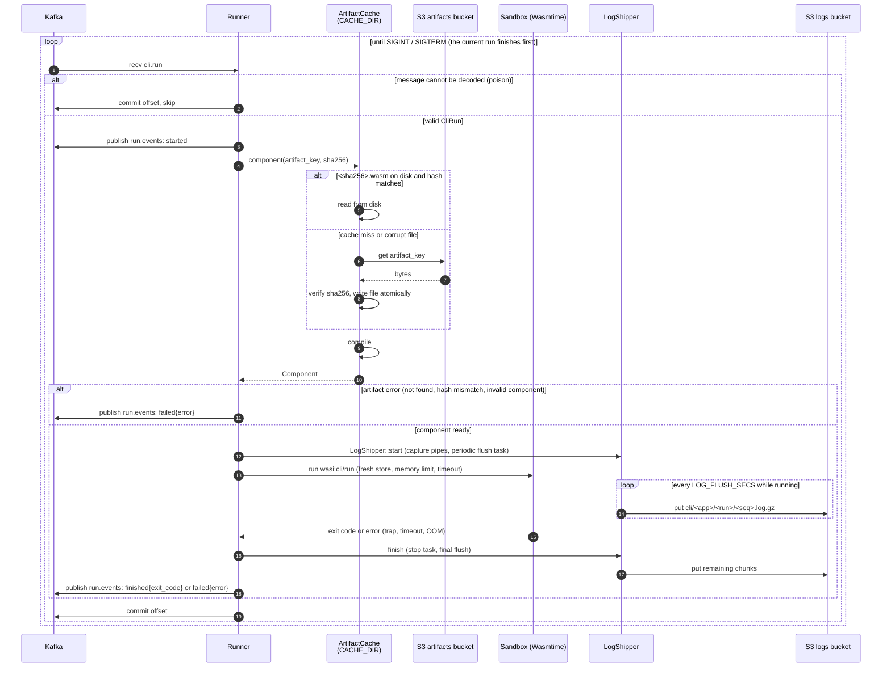

# runner-cli

Consumes `cli.run` and fetches the component from the artifacts bucket. The component is verified by sha256, cached on disk and compiled for each run. Each run gets a fresh Wasmtime sandbox and calls `wasi:cli/run`. stdout/stderr go to the logs bucket as `cli/<app>/<run>/<seq>.log.gz`, and status is published on `run.events` (`started`, then `finished{exit_code}` or `failed{error}`). The offset is committed only after the final event.

## How it works



Receive errors are retried after 1 s. If publishing an event or committing fails, the process exits without committing, so the message is redelivered after a restart.

## Events

runner-cli publishes `RunEvent`s (`common::bus::messages::run_event`) on **`run.events`**, as JSON, partitioned by `app_id`. Every event carries `run_id`, `app_id` and `at` (the UTC time it was created), plus a `type`:

| `type` | Extra fields | When |
|--------|--------------|------|
| `started` | none | A valid `cli.run` message was received, before the artifact is fetched. |
| `finished` | `exit_code` | The guest ran to completion. `0` means success. Any non-zero `exit(n)` arrives as `1`, because wasip2 can only report success or failure. |
| `failed` | `error` | The run could not complete (see below). |

```json
{"run_id":"…","app_id":"…","at":"2026-11-03T12:00:00Z","type":"started"}
{"run_id":"…","app_id":"…","at":"2026-11-03T12:00:01Z","type":"finished","exit_code":0}
{"run_id":"…","app_id":"…","at":"2026-11-03T12:00:01Z","type":"failed","error":"timed out after 1s"}
```

A run produces exactly two events: `started`, then either `finished` or `failed`. Runs are processed one at a time, so the events of different runs from one runner do not interleave.

`error` is a human-readable message. These prefixes are stable:

| `error` starts with | Cause |
|---------------------|-------|
| `invalid sha256` | `sha256` in the message is not 64 hex characters |
| `artifact … not found` | nothing stored under `artifact_key` |
| `sha256 mismatch` | the stored bytes do not match `sha256` |
| `invalid component` | not a wasm component, or compilation failed |
| `artifact storage` / `artifact cache io` | the artifacts bucket or local cache failed |
| `timed out after` | the run exceeded its timeout (`timeout_secs`, default `RUN_TIMEOUT_SECS`, capped at `RUN_MAX_TIMEOUT_SECS`) |
| anything else | the guest trapped: a panic (`unreachable`), exceeding `MEMORY_LIMIT_MB`, or failing to instantiate |

Guarantees:
- **Logs first.** All log chunks of a run are uploaded before its `finished` or `failed` event, so a consumer can read complete logs as soon as it sees the event.
- **Commit last.** The `cli.run` offset is committed after the final event. Runs that end in `failed` are committed too, because retrying would fail the same way.
- **No event for poison messages.** A `cli.run` message that cannot be decoded, including one with a malformed `artifact_key`, is logged, committed and skipped.
- **At-least-once.** If the process dies, or publishing an event or committing fails, the message is redelivered after a restart. The same `run_id` can then show up with a second `started` and a second final event, so consumers should deduplicate on `run_id`.

## Run

```sh
cargo run -p runner-cli   # needs Kafka + Garage, see docs/design.md → Local Development
cargo test -p runner-cli  # no external services: in-memory Kafka + S3 from common, guest in test-guest/
```

## Configuration

Shared variables come from `<root>/.env` (`KAFKA_BROKERS`, `S3_*`, `ARTIFACT_BUCKET`, `LOG_BUCKET`, `RUST_LOG`). Runner-specific variables come from `runner-cli/.env`. `.env.local` overrides either file.

Each bucket gets its own S3 client. Credentials default to the shared `S3_ACCESS_KEY` / `S3_SECRET_KEY` and can be overridden per bucket with `ARTIFACT_S3_ACCESS_KEY` / `ARTIFACT_S3_SECRET_KEY` and `LOG_S3_ACCESS_KEY` / `LOG_S3_SECRET_KEY` (set both of a pair or neither). In production, runner-cli should get a read-only key for the artifacts bucket and a write-only key for the logs bucket.

| Var | Default | |
|-----|---------|-|
| `KAFKA_GROUP_ID` | `runner-cli` | consumer group |
| `CACHE_DIR` | `/var/cache/runner-cli` | sha256-keyed artifact cache |
| `RUN_TIMEOUT_SECS` | `300` | default wall-clock limit |
| `RUN_MAX_TIMEOUT_SECS` | `3600` | cap for a message's `timeout_secs` |
| `MEMORY_LIMIT_MB` | `256` | linear memory per run |
| `LOG_FLUSH_SECS` | `5` | chunk upload interval while running |
| `LOG_MAX_BYTES` | `10485760` | per stream; excess dropped with a marker |

## Sandbox

Engine setup, store limits, the artifact cache and output capture come from [`runner-core`](../runner-core/README.md), shared with runner-http.

Every run gets a fresh store and instance, with no preopened directories and no network. Memory is capped by `StoreLimits`. The timeout is enforced by epoch interruption, ticking every 100 ms.

Runs are processed one at a time per process; scale out with replicas.

## Tests

`tests/run.rs` runs the real `Runner` on a background task against `MemoryBus` and `MemoryStorage` from `common` (feature `mock`). Each test acts like the control plane: it uploads [`test-guest`](test-guest/src/main.rs) through the typed artifact store, publishes `cli.run` messages, and asserts on the events on `run.events`, the log chunks in the logs bucket and the committed offsets. The first argument picks the guest's behavior (`echo`, `exit`, `panic`, `spin`, `sleep`, `alloc`, …), so a single artifact covers every outcome listed above. The tests build the guest themselves, which needs the `wasm32-wasip2` target (`rustup target add wasm32-wasip2`).
