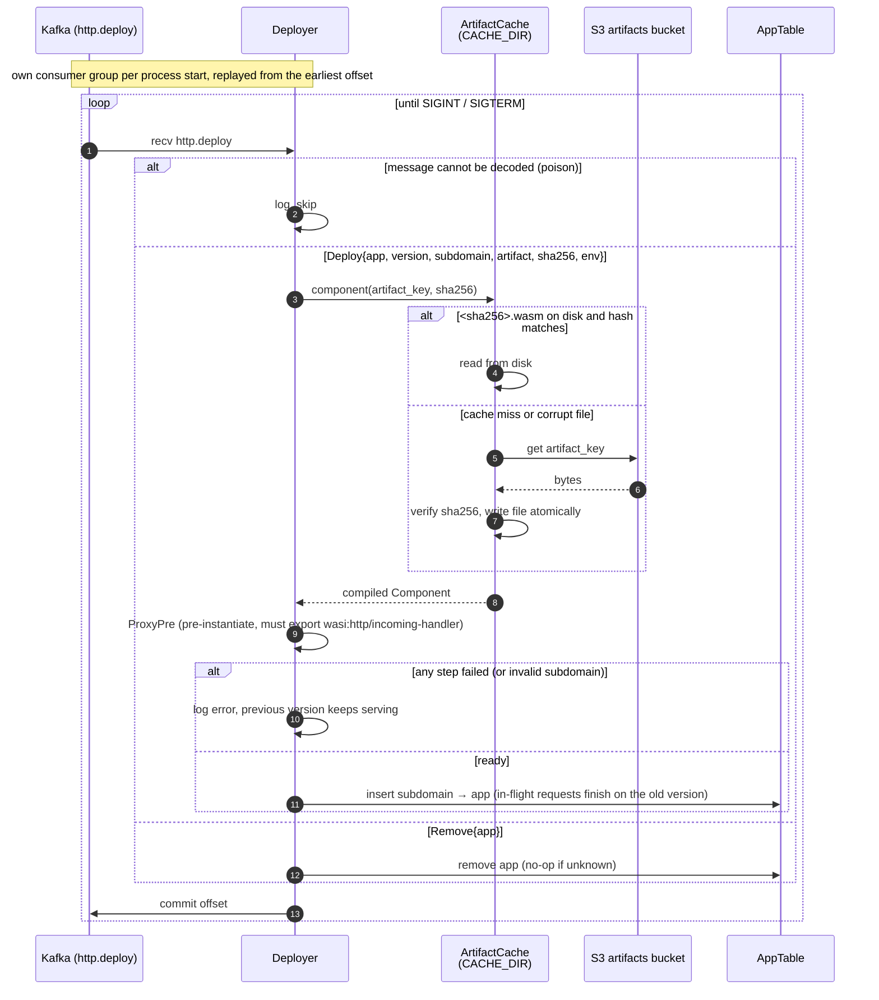
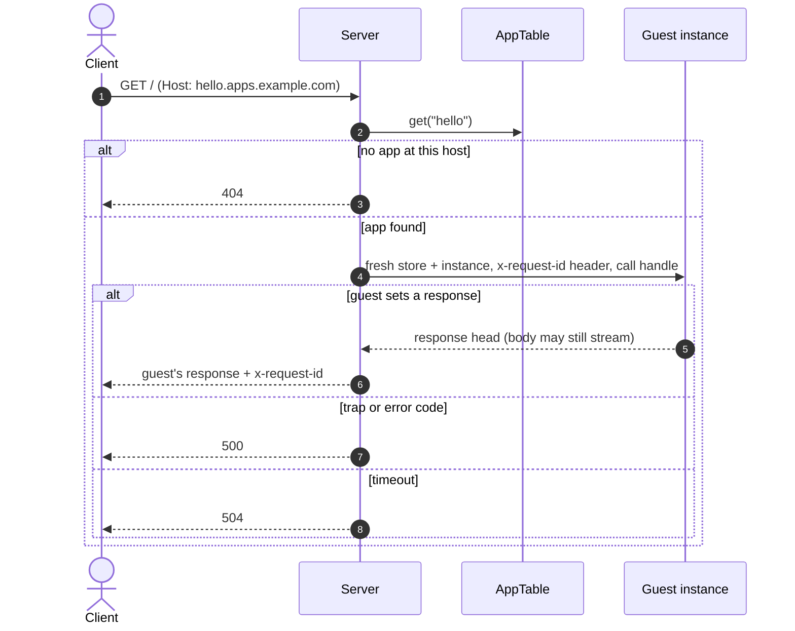

# runner-http

Serves HTTP apps: WASM components that export `wasi:http/incoming-handler`. It consumes `http.deploy` to learn which app version is served at which subdomain, routes every request by its `Host` header (`<subdomain>.<APPS_DOMAIN>`), and runs it in a fresh Wasmtime instance. Guest stdout/stderr is discarded for now (app logging is on the [roadmap](../README.md#roadmap)). runner-http publishes no Kafka messages.

## How it works

### Deploys



- **Every replica serves every app**, so every replica must see every `http.deploy` message. Each process start uses its own consumer group (`runner-http.<pod>.<random>`) and reads the topic from the earliest offset to rebuild the routing table. The topic should be log-compacted by `app_id` so this replay stays short. Because of this, offsets are committed only as a progress marker: a failed commit is logged, not fatal.
- `Deploy` fetches the artifact (verified by sha256, cached on disk), compiles it, and pre-instantiates it (`ProxyPre`). Only then does the new version replace the old one in the table. Requests already running on the old version finish on it.
- A changed `subdomain` frees the old one. If another app already holds the subdomain, the latest deploy wins and a warning is logged.
- **A deploy that fails** (artifact not found, hash mismatch, not a component, no `wasi:http/incoming-handler` export, invalid subdomain) is logged, and the app keeps serving its previous version, if it had one.
- `Remove` stops serving the app. Removing an unknown app does nothing.
- Undecodable (poison) messages are logged and skipped.

### Requests



| Request                                                                              | Response                                               |
| ------------------------------------------------------------------------------------ | ------------------------------------------------------ |
| `Host: <subdomain>.<APPS_DOMAIN>` (case-insensitive, any port), app deployed         | the guest's response                                   |
| subdomain not deployed, nested subdomain (`a.b.<domain>`), or `<APPS_DOMAIN>` itself | `404`                                                  |
| any other host, path `/healthz`                                                      | `200 ok` (for liveness/readiness probes on the pod IP) |
| any other host, any other path                                                       | `404`                                                  |
| guest traps (panic, out of memory) or returns an error code                          | `500 internal error`                                   |
| guest exceeds `REQUEST_TIMEOUT_SECS`                                                 | `504 request timed out`                                |

- Every response carries `x-request-id`. The guest sees the same value in its request's `x-request-id` header, and a client-supplied value is replaced. Error responses never include guest details; failures are recorded in the runner's own `tracing` output with the app id and request id.
- `x-forwarded-proto: https` (set by the gateway) makes the guest see the `https` scheme. Otherwise the guest sees `http`.
- **Sandbox per request:** a fresh store and instance, created from the pre-instantiated component. It gets the deploy's `env`, a `MEMORY_LIMIT_MB` memory cap, no preopened directories and no sockets. **Outgoing HTTP is denied**: `wasi:http/outgoing-handler` is linked, so components that import it still load, but every request fails without opening a connection.
- **Timeout:** the epoch deadline covers the whole request, including streaming the response body. A CPU-bound guest yields to the executor every 100 ms, so it can't starve other requests on the same worker thread. A guest blocked in a host call is stopped by a backstop 5 s after the timeout.
- Only HTTP/1.1 is served. TLS, HTTP/2, rate limits and body size limits are handled by the gateway.

### Shutdown

On SIGINT/SIGTERM the server stops accepting connections and waits up to `REQUEST_TIMEOUT_SECS + 10 s` for in-flight requests (and their guest tasks). It then stops consuming deploys.

## Run

```sh
cargo run -p runner-http   # needs Kafka + Garage, see docs/design.md → Local Development
curl http://hello.apps.localhost:8080/   # after deploying an app with subdomain "hello"
cargo test -p runner-http  # no external services: in-memory Kafka + S3 from common, guest in test-guest/
```

## Configuration

Shared variables come from `<root>/.env` (`KAFKA_BROKERS`, `S3_*`, `ARTIFACT_BUCKET`, `RUST_LOG`). Runner-specific variables come from `runner-http/.env`. `.env.local` overrides either file. Each bucket gets its own S3 client. Credentials default to the shared `S3_ACCESS_KEY` / `S3_SECRET_KEY` and can be overridden per bucket with `ARTIFACT_S3_ACCESS_KEY` / `ARTIFACT_S3_SECRET_KEY` (set both of a pair or neither). In production, give runner-http a read-only artifacts key.

| Var                          | Default                   |                                                                                   |
| ---------------------------- | ------------------------- | --------------------------------------------------------------------------------- |
| `APPS_DOMAIN`                | required                  | apps are served at `<subdomain>.<APPS_DOMAIN>` (dev: `apps.localhost`)            |
| `LISTEN_ADDR`                | `0.0.0.0:8080`            |                                                                                   |
| `POD_NAME`                   | `$HOSTNAME`, else `local` | replica name, used in the consumer group id                                       |
| `CACHE_DIR`                  | `/var/cache/runner-http`  | sha256-keyed artifact cache                                                       |
| `REQUEST_TIMEOUT_SECS`       | `30`                      | wall-clock limit per request                                                      |
| `MEMORY_LIMIT_MB`            | `128`                     | linear memory per request instance                                                |

## Code layout

| Module   |                                                                                                            |
| -------- | ---------------------------------------------------------------------------------------------------------- |
| `runner` | `Runner`: wires the deployer and the HTTP server; graceful shutdown                                        |
| `deploy` | `Deployer`: `http.deploy` → `AppTable`                                                                     |
| `apps`   | `AppTable`: subdomain → `Arc<App>` (version, env, `ProxyPre`)                                              |
| `server` | `Host` routing, request id, per-request instance, error → status mapping                                   |
| `guest`  | store data (`GuestState` wraps runner-core's `HostState` + `WasiHttpCtx`), linker, outgoing-request denial |

Engine, store limits, timeouts and the artifact cache come from [`runner-core`](../runner-core/README.md).

## Tests

`tests/serve.rs` starts the real `Runner` on a TCP port against `MemoryBus` and `MemoryStorage` from `common` (feature `mock`). Each test acts like the control plane and a client:

- it uploads [`test-guest`](test-guest/src/main.rs) through the typed artifact store and publishes `http.deploy` messages, waiting until each is committed
- it sends HTTP requests with a `Host` header
- it checks the responses and the committed offsets

The request path picks the guest's behavior (`/env/<name>`, `/echo`, `/status/<code>`, `/spin`, `/panic`, `/alloc/<mib>`, `/fetch`, `/sleep/<ms>`, …). The tests build the guest themselves, which needs the `wasm32-wasip2` target.
